<p align="center">
  
</p>

<p align="center">
  <strong>A small, self-hosted register for lending out equipment.</strong><br>
  Who has the laptop, since when, and when is it coming back.
</p>

<p align="center">
  
  
  
  
  
</p>

---

## Why Tally exists

Most IT teams I know lend equipment the same way: a laptop goes out for a conference, a projector for a weekend event, a headset for someone working from home. The "system" is usually a spreadsheet, a paper form in a drawer, and a lot of memory. It works until someone asks where the second projector is.

Tally replaces that with a register that is quick to fill in and hard to get wrong. You record a loan in a few seconds, print a numbered slip for the borrower to sign, and the register keeps track of what is out, what is due and what is late. When the equipment comes back, you tick it off.

It is deliberately small. One Node.js process, one SQLite file, no database server, no build step, no framework. You can run it on an old desktop under a desk, on a NAS, or in a container, and back it up by copying one file.

<p align="center">
  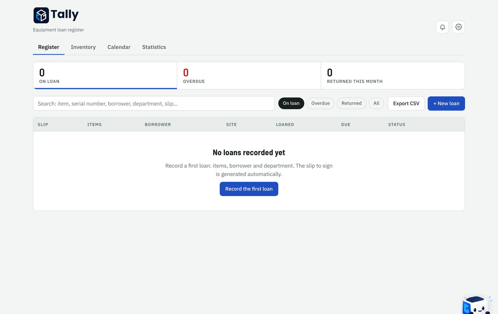
</p>

## Contents

- [What it does](#what-it-does)
- [Screenshots](#screenshots)
- [Getting started](#getting-started)
- [Configuration](#configuration)
- [Running it for real](#running-it-for-real)
- [A day with Tally](#a-day-with-tally)
- [Settings, section by section](#settings-section-by-section)
- [The Tally helper](#the-tally-helper)
- [Keyboard shortcuts](#keyboard-shortcuts)
- [Your data](#your-data)
- [Updating](#updating)
- [Troubleshooting](#troubleshooting)
- [Roadmap](#roadmap)
- [For developers](#for-developers)
- [Contributing and security](#contributing-and-security)
- [License and credits](#license-and-credits)

## What it does

**The register.** Every loan has a borrower, a department, a site, dates and one or more items with their serial number, asset tag, accessories and condition. The list shows what is on loan, what is due soon and what is overdue, and the three counters at the top double as filters. Returns can be partial: if two of three items come back, the loan stays open for the third. Loans can be extended with a reason, and every extension is kept.

**The inventory.** Your equipment, each item with a green or red dot for available or on loan. Lending something from the inventory takes two clicks, and Tally refuses to lend an item that is already out. Click any serial number or borrower to see their full history.

**Reservations and the calendar.** Book an item for future dates and turn the booking into a loan on the day. Tally refuses overlapping bookings and warns when a loan or an extension would run into someone else's reservation. The calendar shows loans and reservations month by month.

**The loan slip.** A printable A4 slip with a number that is never reused (`PR-2026-0001`), your logo, the items, the borrower, your own agreement text, signature boxes and a section for the return. A QR code on the slip opens the loan straight in Tally. Signatures can also be taken on screen, with a finger or a mouse.

**Statistics.** Loans per month, the most borrowed items and categories, the people and departments who borrow the most, filtered by period and site.

**Archive.** Old, returned loans can be moved out of the way automatically after a period you choose. They leave the register and the statistics but stay in the archive, where you can look them up, download them as a text file or delete them for good.

**The Tally helper.** A little cube in the corner of the screen who answers questions, runs quick tasks, keeps a shared notepad with pins and reminders, and warns you about clashes while you record a loan. More on him [below](#the-tally-helper).

**Around the edges.** French and English, twelve themes including a dark one, a choice of date formats, undo after deleting, notifications for loans due soon, keyboard shortcuts, CSV import and export, one-click backup and restore, and a short guided setup on first launch. It can be installed as an app from Chrome, Edge or Safari, and it works with a keyboard and a screen reader.

## Screenshots

All screenshots are from a fresh install, before any data is added.

| | |
|---|---|
| 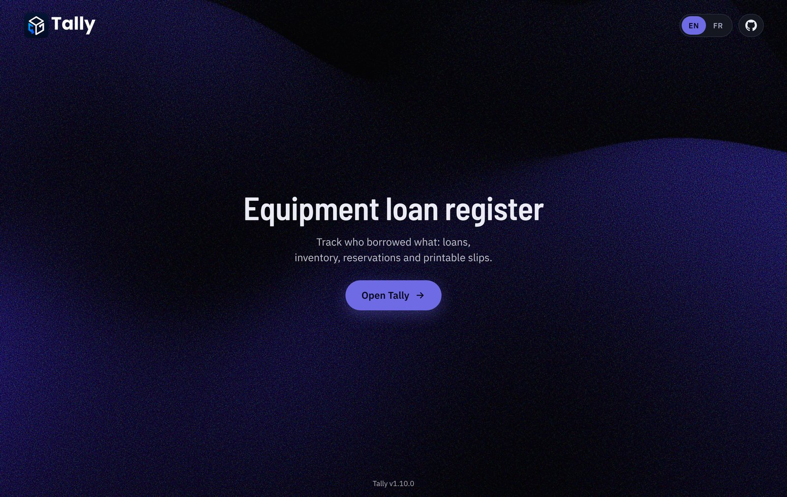 | 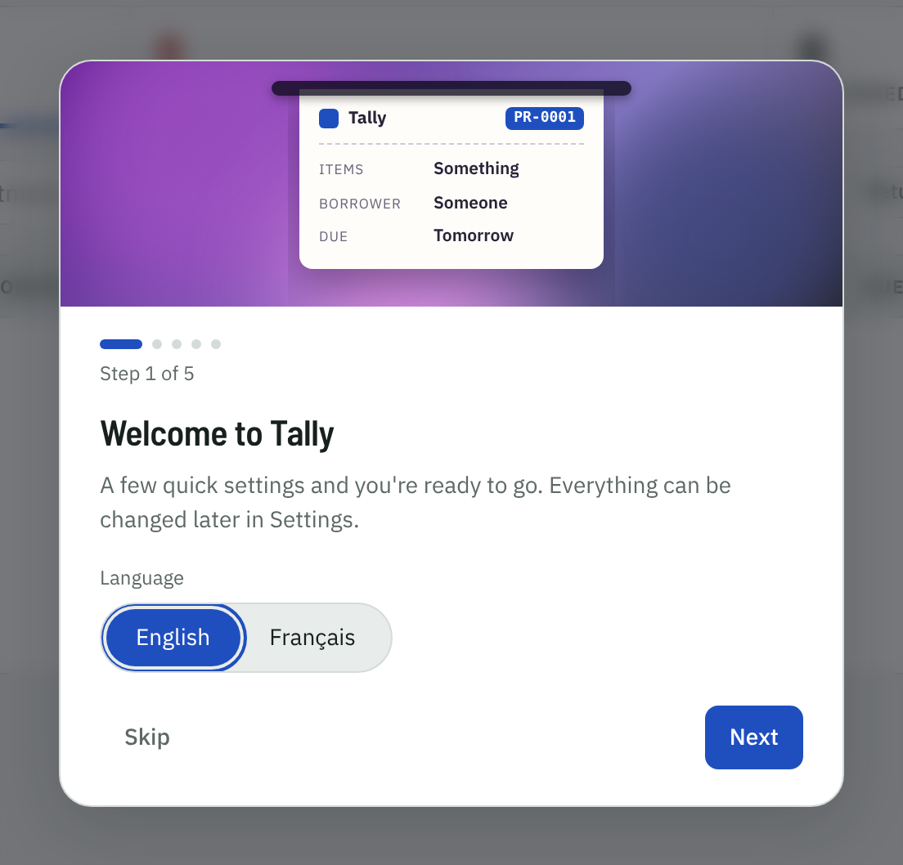 |
| The landing page at `/` | First launch: a short guided setup |
| 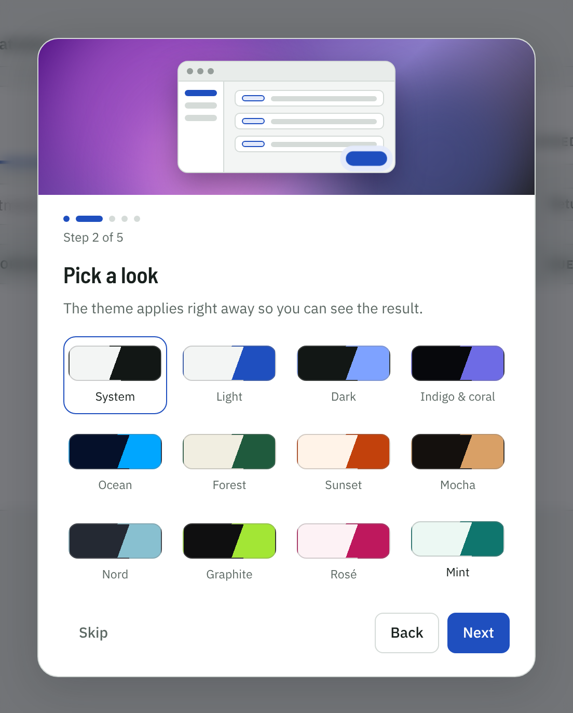 | 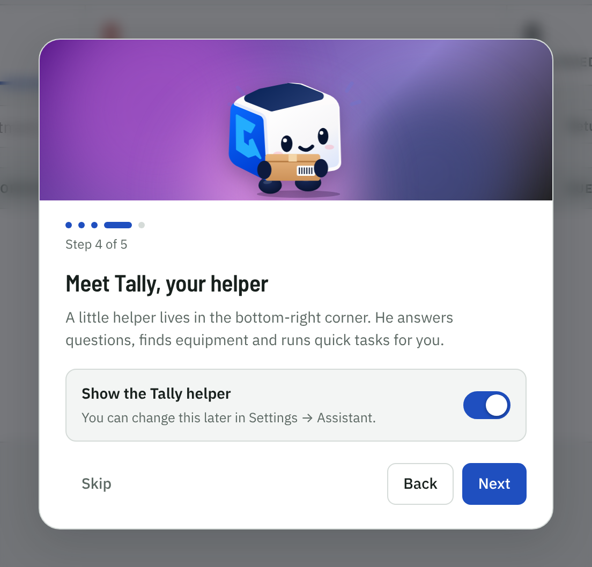 |
| Pick a theme, it applies straight away | Meet the helper, or switch him off |
| 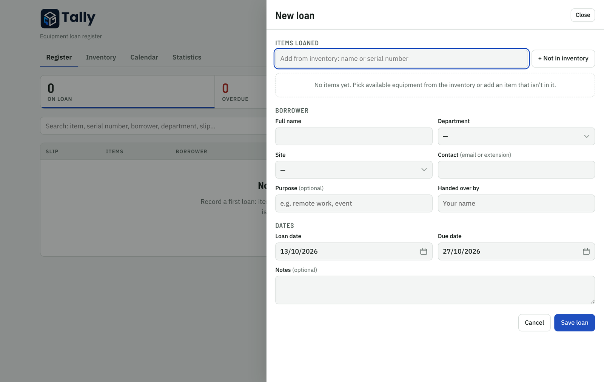 | 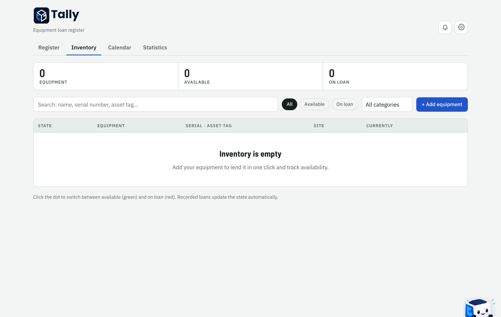 |
| Recording a loan | The inventory |
| 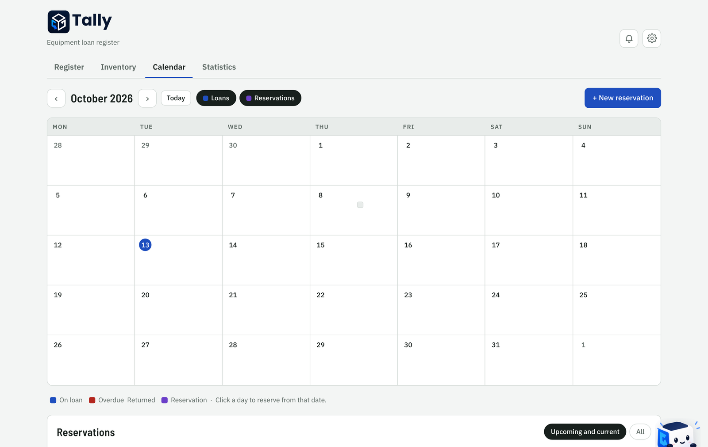 | 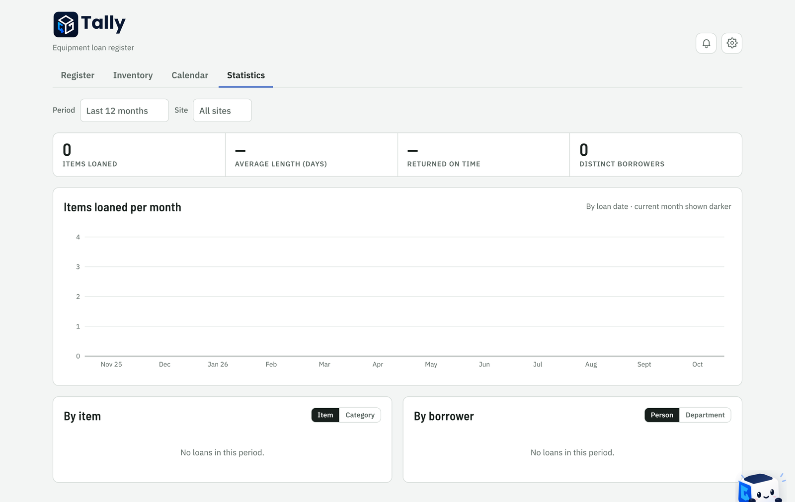 |
| Loans and reservations by month | Statistics |
| 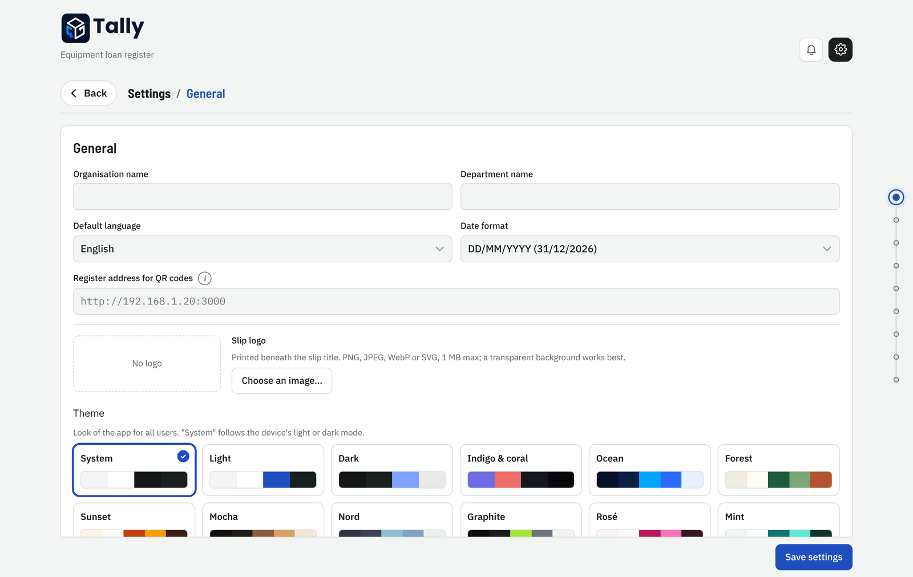 | 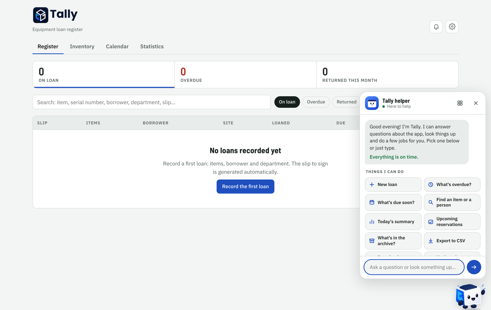 |
| Settings, with the section rail on the right | The helper's chat panel |

<p align="center">
  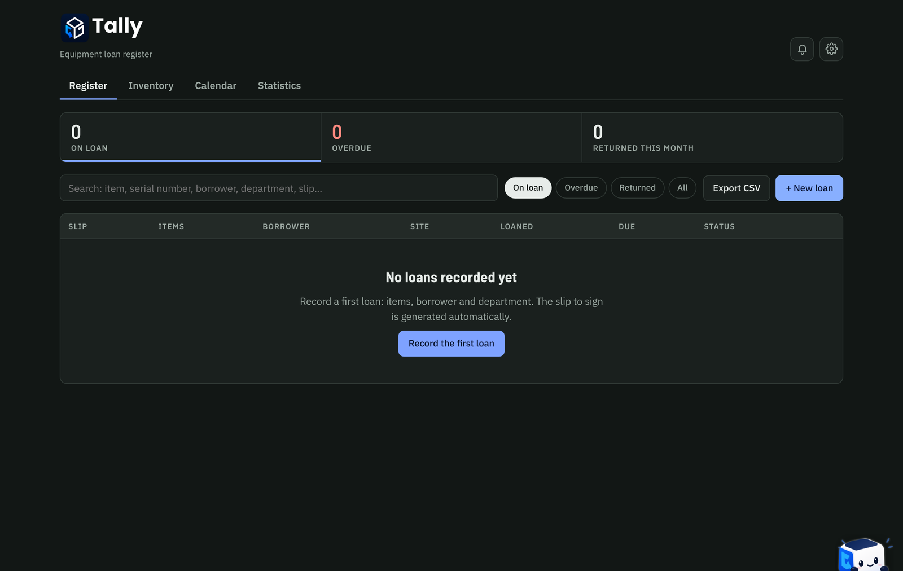<br>
  <sub>The register in the Dark theme</sub>
</p>

## Getting started

You need **Node.js 22.13 or newer** (Node 24 is what I use). Nothing else: Tally uses the SQLite engine built into Node, so there is no native module to compile and no database to install.

```bash
git clone https://github.com/Alex-Mlts/tally.git
cd tally
npm install
npm start
```

Open <http://localhost:3000>. The landing page has an **Open Tally** button; the register itself lives at `/app`.

On the first visit a setup card asks for the language, a theme, your organisation's name, the prefix for slip numbers, the default loan length and whether you want the helper. Everything it asks can be changed later in Settings, and you can skip it entirely.

Node may print a warning that SQLite is an experimental feature. It is harmless.

## Configuration

Tally reads four environment variables. Everything else is set from the Settings page.

| Variable    | Default  | What it does |
|-------------|----------|--------------|
| `PORT`      | `3000`   | The HTTP port. |
| `DATA_DIR`  | `./data` | Where the database (`tally.db`) and safety copies are kept. |
| `AUTH_USER` | empty    | With `AUTH_PASS`, turns on a login prompt (HTTP Basic authentication). |
| `AUTH_PASS` | empty    | The password for that login. |

```bash
PORT=8080 DATA_DIR=/srv/tally AUTH_USER=it AUTH_PASS='a long passphrase' npm start
```

> [!IMPORTANT]
> Tally has no user accounts yet. Without `AUTH_USER` and `AUTH_PASS`, anyone who can reach the port can read and change the register. Keep it on your internal network, and if you turn on the login, serve it over HTTPS so the password is not sent in clear text.

## Running it for real

### Docker

```bash
docker build -t tally .
docker run -d --name tally \
  -p 3000:3000 \
  -v tally-data:/data \
  -e AUTH_USER=it -e AUTH_PASS='a long passphrase' \
  --restart unless-stopped \
  tally
```

The database lives in the `tally-data` volume, so you can rebuild or replace the container without losing anything.

### As a service on Linux

A minimal systemd unit, assuming Tally is in `/opt/tally` and runs as a user called `tally`:

```ini
[Unit]
Description=Tally equipment loan register
After=network.target

[Service]
User=tally
WorkingDirectory=/opt/tally
Environment=PORT=3000 DATA_DIR=/var/lib/tally
ExecStart=/usr/bin/node server.js
Restart=on-failure

[Install]
WantedBy=multi-user.target
```

### Behind a reverse proxy

Tally is happy behind nginx, Caddy or Traefik. With Caddy it is a single line:

```
tally.example.internal {
  reverse_proxy localhost:3000
}
```

Then set **Register address for QR codes** in Settings → General to the address people will actually use (for example `https://tally.example.internal`). The QR codes on slips point there, and so do link previews when someone pastes the address into a chat.

## A day with Tally

1. **Someone needs a laptop.** Press `N` (or **+ New loan**), start typing the model or serial number and pick it from the inventory. If it is not in the inventory yet, add it by hand and tick the box to keep it. Fill in who is borrowing it and until when, and save. If something looks off, such as a reservation coming up or a borrower who is already late, a "Tally noticed" box tells you before you do.
2. **The slip opens.** Print it twice, one for the borrower and one for you, and have it signed. With on-screen signatures turned on, they can sign right there instead.
3. **A few days later**, the bell in the corner starts counting loans that are due soon. Late ones turn red in the register.
4. **It comes back.** Click **Return**, tick what came back and note its condition. If only part of the loan is back, the rest stays open.
5. **Someone wants it next week.** Open the calendar and click a day to reserve it. On the day, **Convert to loan** turns the booking into a loan with the same items.

Each tab has its own address you can bookmark or share: `/app#register`, `/app#inventory`, `/app#calendar`, `/app#statistics` and `/app#settings`. The older French addresses (`#registre`, `#inventaire`, `#calendrier`) still work.

The list refreshes on its own every 30 seconds, so colleagues using Tally at the same time see each other's changes.

## Settings, section by section

The gear icon opens Settings. While you are there, the tabs give way to a **Back** button, a rail on the right shows which section you are in, and the helper stays hidden.

- **General**: organisation and department names (printed on the slip), language, date format, the address used in QR codes, the slip logo and the theme. The language and the theme apply to everyone using this server.
- **Assistant**: turn the Tally helper on or off.
- **Archive**: turn on automatic archiving and choose after how long a returned loan is archived (3 months to 5 years). From here you can view the archive, download it as a `.txt` list, delete selected loans or empty it.
- **Accessibility**: text size, higher contrast, reduced motion and a stronger focus outline. These are saved in your browser only, so each person can choose their own.
- **Loans**: default loan length, how many days before the due date a loan counts as "due soon", the slip number prefix, how often the list refreshes, whether "Handed over by" is required, and on-screen signatures.
- **Pick lists**: the sites, departments and categories offered in the forms. While the departments list is empty, the department field is optional.
- **Slip**: the agreement text printed above the signatures, one rule per line.
- **Integrations**: what is coming, see the [roadmap](#roadmap). The eye button hides the section if you would rather not see it.
- **Data**: CSV export and import, download a backup, restore from a backup. The **i** next to the title explains each one.

The footer shows the version, a **What's new** link with the full changelog, a Help button with the keyboard shortcuts, and a link to the source.

## The Tally helper

<p align="center">
  <br>
  <sub>The Tally mascot and his expressions</sub>
</p>

The helper is the cube in the bottom-right corner. Most of the time he just peeks over the edge of the screen. Point at him and he pops up to say hello; leave him alone for a while and he takes a nap, puts on sunglasses or gets some work done on his laptop. Every answer he gives comes with its own expression, from the magnifying glass when he searches to the warning sign when something is late.

Click him, or press `H`, to open his panel. He can:

- start a new loan,
- tell you what is overdue and what is due soon, with links straight to each loan,
- find an item or a person by serial number, asset tag, model or name and tell you where it is,
- give you a summary of the day,
- list upcoming reservations,
- tell you what is in the archive,
- export the register to CSV or download a backup,
- answer common questions, such as how returns, slips, extensions, signatures, the archive, backups, reservations or the colours work.

### Notes

The wide **Notes** button at the top of his menu opens a shared notepad: a cable to order, a laptop to reimage, who to chase on Monday.

- **Add** a note by typing and pressing `Enter` (`Shift` + `Enter` for a new line), or type `note: order HDMI cables` in the chat without leaving the conversation.
- **Pin** the notes that matter. Pinned notes stay at the top of the list.
- **Set a reminder date.** On that day the note shows up in the bell with the loan alerts, and the helper mentions it when you open him. Reminders that are late turn red.
- **Tick** a note off when it is done, **click** it to edit it, or delete it with the bin.
- **Back to chat** (or `Esc`) takes you back to the conversation.

Notes are stored on the server, so everyone using Tally sees the same list, and they are part of every backup.

### Smart warnings

While you fill in a new loan, the helper keeps an eye on it and points out anything worth a second look before you save, in a small "Tally noticed" box above the buttons:

- one of the items is **reserved by someone else** during the loan or within three days after it,
- the borrower **already has an overdue loan**,
- the due date falls on a **Saturday or Sunday**,
- there is an open **note about one of the items**, matched by serial number or asset tag.

The warnings never block you. They are there so you can shorten a loan, move a reservation or chase the old one first.

### Privacy

He works entirely in your browser from the data Tally has already loaded, apart from notes, which live on your own server. There is no AI service behind him and nothing is sent anywhere else. He understands keywords, so short questions work best: "who has SN-4471", "what's late", "how do I extend a loan".

If he is not your thing, switch him off in Settings → Assistant or during the first-run setup. The smart warnings keep working without him.

## Keyboard shortcuts

Shortcuts are ignored while you are typing in a field. Press `?` in the app to see this list.

| Keys | What they do |
|------|--------------|
| `1` `2` `3` `4` | Register, Inventory, Calendar, Statistics |
| `,` | Settings |
| `N` | New loan, item or reservation, depending on the tab |
| `/` | Search |
| `H` | Open the Tally helper |
| `?` | Show the shortcuts |
| `←` `→` | Previous or next month in the calendar |
| `T` | Today in the calendar |
| `Ctrl` + `Enter` (`⌘` + `Enter` on a Mac) | Save the form that is open |
| `Esc` | Close the open window |

## Your data

Everything lives in one file: `tally.db` in the data folder.

**Backups.** Settings → Data → **Download a backup** gives you a consistent copy of the database while Tally keeps running. From the command line, `sqlite3 data/tally.db ".backup 'tally-$(date +%F).db'"` does the same. A copy is only a backup once it is somewhere else, so put it on another machine.

**Restoring.** Settings → Data → **Restore from a backup (.db)**. Tally first saves the current database as `before-restore-<date and time>.db` in the data folder, then replaces everything with the contents of the file you chose. You can also stop the server and replace `tally.db` by hand.

**CSV export.** One row per item, `;` as separator, UTF-8. It opens cleanly in Excel and is a readable record in its own right.

**CSV import.** Adds equipment to the inventory. Tally recognises columns for name, category, serial number, asset tag, site and notes, in English or French, with `;`, `,` or tab separators. You get a preview first that shows which rows are new, which are already in the inventory and which are invalid, and nothing is saved until you confirm. A template is available from the same panel.

**Starting over.** Stop the server and delete `tally.db`. The next start creates an empty one and shows the setup card again.

## Updating

1. Stop Tally.
2. Replace the files with the new version (or `git pull`).
3. Run `npm install`.
4. Start Tally again.

Your data stays where it is, and the database is upgraded automatically when needed. After updating, reload the page once (`Ctrl` + `F5`); a banner then points you to what changed. If the page warns that the server is older than the page, the old process is still running somewhere: stop it and start Tally again.

Coming from a version older than 1.10.0? The database used to be called `registre.db`. On the first start, Tally renames it to `tally.db` for you; nothing else changes.

Coming from a version older than 1.2.0, which had no inventory? On the first start, Tally turns the serial numbers of your existing loans into inventory items. Take a backup before updating, just in case.

## Troubleshooting

**QR codes on slips open `localhost` on phones.** Set **Register address for QR codes** in Settings → General to an address phones can reach, for example `http://192.168.1.20:3000`.

**Tally stops right away with `EADDRINUSE`.** Another program, or another copy of Tally, is already using the port. Stop it, or start Tally on another port with `PORT=3001 npm start`.

**The page looks old after an update.** Reload with `Ctrl` + `F5` to drop the cached files.

**An item cannot be deleted.** It is on loan or reserved. Return it or cancel the reservation first.

**The helper is gone.** He is switched off in Settings → Assistant, or you are on the Settings page, where he always stays hidden.

**Something else.** Open an [issue](https://github.com/Alex-Mlts/tally/issues) with what you did, what you expected and what happened.

## Roadmap

This is where Tally is heading. It is a list of intentions, not promises, and the order can change depending on what people actually need. If something here matters to you, say so in an issue: that is the best way to move it up.

### Next

- **Email reminders.** Optional emails to borrowers a few days before a loan is due and when it is late, sent through your own SMTP server, plus a heads-up for reservations starting soon.
- **Calendar feed.** A subscribable ICS link so due dates and reservations show up in Outlook, Google Calendar or a phone.
- **Barcode and QR scanning.** Check items out and back in with a USB scanner or a phone camera, by asset tag or serial number.
- **Greek and more languages.** The interface is already fully translatable; the next step is making it easy to add a language without touching the code.

### Integrations

Settings → Integrations already lists these as "Coming soon". Each one will be optional and off by default.

- **Inventory tools.** Import and keep in sync with Snipe-IT, GLPI or HomeBox, matched by asset tag, with a link back to the original record.
- **People directory.** Pick borrowers from Microsoft Entra ID, Google Workspace or LDAP instead of typing names.
- **Notifications.** Webhooks that post to Teams, Slack, Discord or any URL when a loan is created, returned or late.
- **Monitoring.** A health and metrics endpoint for Uptime Kuma, Prometheus and friends.

### Tally 2.0

These would change how Tally works, so they are saved for a major version.

- **User accounts and roles** (admin, staff, read-only) with an audit log, so "Handed over by" fills itself in and settings can be locked down.
- **Borrowers as real records**, with contact details and a proper history per person.
- **Quantities and kits.** Lend "10 HDMI cables" without ten serial numbers, or a laptop, its charger and its bag as one kit.
- **A versioned API with tokens**, so other tools can talk to Tally safely.

## For developers

### Stack

- **Backend**: Node.js and Express. The database is SQLite through the built-in `node:sqlite` module, in a single file.
- **Frontend**: plain HTML, CSS and JavaScript in `public/`. No framework and no build step; edit a file and reload.
- **Landing page gradient**: a prebuilt [ShaderGradient](https://github.com/ruucm/shadergradient) bundle. Its source is in `tools/gradient`.

### Project layout

```
server.js          The server: database schema and migrations, API, archive job, changelog reader
CHANGELOG.md       Release notes, also shown in the app under "What's new"
Dockerfile
public/
  landing.html     Landing page (/)
  app.html         The register (/app)
  404.html         Not-found page
  app.js           Application code
  helper.js        The Tally helper: the mascot, drawn in SVG, and his answers
  i18n.js          French and English texts
  style.css        Styles
  themes.css       Colour themes
  mascot.webp      The mascot picture used in Settings
  vendor/          Prebuilt landing gradient
tools/gradient/    Source and build script for the landing gradient
docs/              Screenshots and the mascot expression sheet used in this README
```

The server keeps `app.html`, `landing.html` and `404.html` in memory once started, so restart it after editing those files. To rebuild the landing gradient, run `npm install` and `npm run build` inside `tools/gradient`.

### API

Everything the interface does goes through a small JSON API. It is not versioned yet (see the [roadmap](#tally-20)), so treat it as internal and expect it to change.

| Method | Route | Purpose |
|--------|-------|---------|
| GET | `/api/version` | Server version and repository link |
| GET | `/api/changelog` | Release notes, parsed from `CHANGELOG.md` |
| GET | `/api/loans` | All loans that are not archived |
| POST | `/api/loans` | Create a loan; the slip number is assigned here |
| PUT | `/api/loans/:id` | Edit a loan |
| POST | `/api/loans/:id/return` | Record a return, in full or in part |
| POST | `/api/loans/:id/extend` | Extend a loan (`dueDate`, `reason`) |
| GET | `/api/loans/:id/signatures` | On-screen signatures for a loan |
| DELETE | `/api/loans/:id` | Delete a loan; returns an `undo` token |
| GET | `/api/equipment` | The inventory, with each item's current loan |
| POST | `/api/equipment` | Add an item |
| POST | `/api/equipment/import` | Import items from CSV rows; known serial numbers are skipped |
| PUT | `/api/equipment/:id` | Edit an item |
| POST | `/api/equipment/:id/status` | Mark an item available or on loan |
| DELETE | `/api/equipment/:id` | Delete an item (refused while it is on loan or reserved) |
| GET | `/api/reservations` | All reservations |
| POST | `/api/reservations` | Create a reservation |
| PUT | `/api/reservations/:id` | Edit an active reservation |
| POST | `/api/reservations/:id/cancel` | Cancel a reservation |
| DELETE | `/api/reservations/:id` | Delete a reservation |
| POST | `/api/undo/:token` | Bring back something deleted in the last 15 minutes |
| GET | `/api/archive` | Archived loans (`?count=1` for just the number) |
| GET | `/api/archive/export` | The archive as a `.txt` file |
| POST | `/api/archive/delete` | Delete selected archived loans, or all of them |
| GET / POST | `/api/notes` | List notes, or add one (`text`, `pinned`, `remindOn`) |
| PUT / DELETE | `/api/notes/:id` | Edit a note (`text`, `done`, `pinned`, `remindOn` as `YYYY-MM-DD`) or delete it |
| GET / PUT | `/api/settings` | Read or update the shared settings |
| GET / PUT / DELETE | `/api/logo` | The slip logo |
| GET | `/api/backup` | Download a copy of the database |
| POST | `/api/restore` | Replace the database with an uploaded backup |

A new loan takes `borrower`, `department`, `loanDate` and `dueDate` (as `YYYY-MM-DD`) and a list of `items`, each either `{equipmentId}` or `{item, serial, category, assetTag, accessories, conditionOut, addToInventory}`. A return takes `{returnDate, items: [{id, conditionIn, returnNotes}]}`. Add `reservationId` to a new loan to convert that reservation. Undo tokens are kept in memory and are lost when the server restarts.

### Versions and releases

Tally counts versions as `MAJOR.MINOR.PATCH`, one step at a time:

- **Patch** (`1.9.0` → `1.9.1`): fixes and small refinements.
- **Minor** (`1.9.1` → `1.10.0`): new features that do not break anything.
- **Major** (`1.10.0` → `2.0.0`): changes that do.

To make a release, add an entry at the top of `CHANGELOG.md`, bump `version` in `package.json` and `package-lock.json` and `APP_VERSION` in `public/app.js`, and update the badge at the top of this file. The page and the server compare their versions and warn when they differ, which catches a half-finished update.

## Contributing and security

Contributions are welcome, whether it is a bug report, a translation, an idea or a pull request. [CONTRIBUTING.md](CONTRIBUTING.md) explains how to set things up and what a good pull request looks like.

If you find a security problem, please do not open a public issue. [SECURITY.md](SECURITY.md) explains how to report it privately.

## License and credits

Tally is released under the [MIT License](LICENSE). Use it, change it, share it.

It stands on the shoulders of:

- [Express](https://expressjs.com) and the SQLite engine built into [Node.js](https://nodejs.org)
- [qrcode-generator](https://github.com/kazuhikoarase/qrcode-generator) for the QR codes on slips (MIT)
- [ShaderGradient](https://github.com/ruucm/shadergradient) for the landing page background (MIT)
- [IBM Plex](https://www.ibm.com/plex/) and [Barlow](https://tribby.com/fonts/barlow/) for the type
