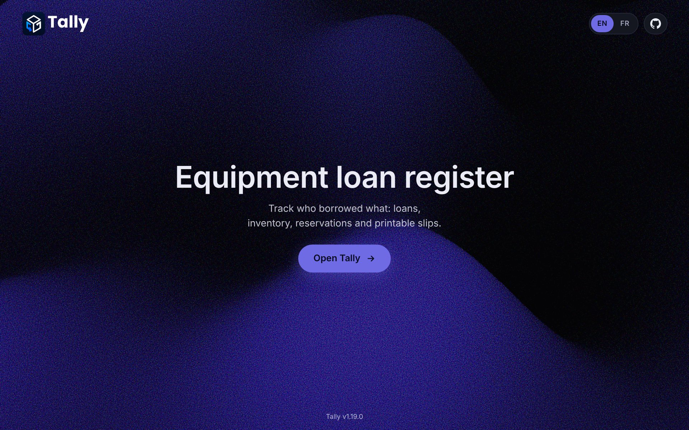
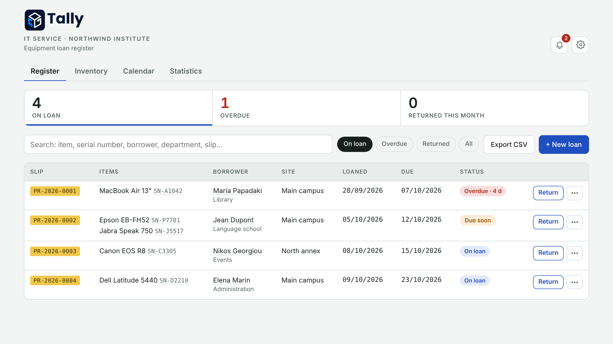
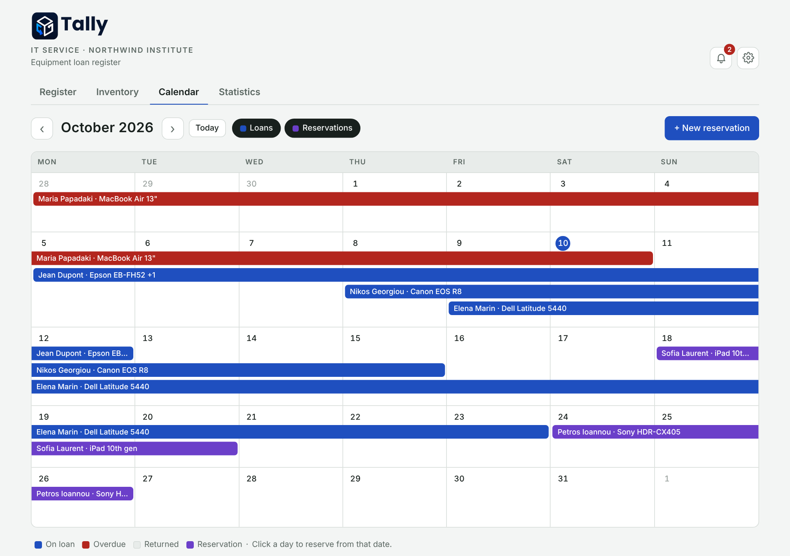

<p align="center">
  
</p>

<p align="center">
  <strong>A self-hosted equipment loan register for IT departments.</strong><br>
  Track who borrowed what, when it is due back, and print a slip to sign.
</p>

<p align="center">
  
  
  
  
</p>

---

Tally records every loan with serial numbers, borrower, department and site. It keeps an inventory, handles returns, extensions and reservations, shows a calendar and statistics, and prints a numbered A4 loan slip with a QR code. It is one small Node.js server and one SQLite file: no database server, no build step, no framework.

<p align="center">
  
</p>

<table>
  <tr>
    <td width="50%"></td>
    <td width="50%"></td>
  </tr>
  <tr>
    <td align="center"><sub>Register: current, due soon and overdue loans</sub></td>
    <td align="center"><sub>Calendar: loans and reservations</sub></td>
  </tr>
</table>

## Contents

- [Features](#features)
- [Quick start](#quick-start)
- [Configuration](#configuration)
- [Docker](#docker)
- [Using Tally](#using-tally)
- [Data: backup, CSV import and export](#data-backup-csv-import-and-export)
- [Updating](#updating)
- [Versioning and releases](#versioning-and-releases)
- [Project layout](#project-layout)
- [API](#api)
- [Future additions](#future-additions)
- [License](#license)
- [Credits](#credits)

## Features

### Loans and inventory

- **Register**: current, due-soon and overdue loans; returns item by item; extensions; loan slips; search and filters. Each row has one main button (Return, or Slip once returned) and a "⋯" menu for the rest; the three summary cards double as filters
- **Multi-item loans**: one slip can cover several items, picked from the inventory or typed by hand. The server refuses to lend an item that is already out
- **Inventory**: your equipment with a status dot (green = available, red = on loan); add, edit and delete items; full history for each item. Delete is refused while an item is on loan or reserved
- **Reservations**: reserve an item for a period and convert the reservation into a loan with one click. The server refuses overlapping reservations, reservations on equipment that is still out on those dates, and loans or extensions that would run into someone else's reservation
- **History**: click a serial number or a borrower to see everything they have had or borrowed
- **Keyboard shortcuts**: `N` new loan / item / reservation, `/` search, `1`–`4` switch tabs, `,` Settings, `?` help, `←` `→` and `T` in the calendar, `Ctrl/⌘ + Enter` save the open form, `Esc` close. A Help button next to the GitHub button in the Settings footer opens the list
- **Undo**: deleting a loan, an item or a reservation shows an "Undo" button; the item comes back exactly as it was, with the same slip number and history

### Slips, calendar and statistics

- **Loan slip**: printable A4, numbered `PR-YYYY-NNNN` (numbers are never reused), with a QR code that opens the loan, your logo, an items table, borrower details, an agreement text you write yourself, signature boxes and a return section. It is printed in the app language
- **Calendar**: monthly view of loans (blue; red when overdue; grey when returned) and reservations (purple). Click a day to create a reservation
- **Statistics**: loans per month, per item (article or category) and per borrower (person or department), filterable by period and site
- **Sortable columns**: click a column header in the register or the inventory to sort ascending, click again for descending, once more to go back to the default order
- **Notifications** (bell): loans due soon, overdue loans and reservations to prepare; the badge counts alerts not yet seen on this browser

### Look and language

- **Bilingual**: French and English. The language is one global setting (Settings → General) that applies to the whole app, the printed slip, the landing page and the messages returned by the server (error texts)
- **First-run setup**: on a fresh install a short animated card asks for language, theme, organisation name, slip prefix and default loan length. Existing installs skip it
- **Date format**: DD/MM/YYYY by default; choose MM/DD/YYYY, YYYY-MM-DD, DD.MM.YYYY or DD-MM-YYYY. It applies everywhere: date fields, slips and CSV export
- **Themes**: System (follows the device), Light, Dark and nine colour themes: Indigo & coral, Ocean, Forest, Sunset, Mocha, Nord, Graphite, Rosé and Mint. The theme applies to everyone
- **Landing page** at `/`: animated gradient, an "Open Tally" button, a GitHub "View source" button and an EN / FR switch (it sets the app language, the same setting as in Settings). The register itself lives at `/app`
- **404 page**: unknown addresses show a branded "Page not found" page; unknown `/api/…` addresses return JSON
- **Installable**: Tally can be installed as an app from the browser (Chrome / Edge: "Install Tally"; iPhone: "Add to Home Screen")
- **Link preview**: sharing the server address in a chat app shows a card with the Tally logo

### Settings

Settings (gear icon) holds: organisation and department names, language, date format, the address used in QR codes, slip logo, theme, default loan length, "due soon" threshold, slip prefix, list refresh rate, "Handed over by" required switch, pick lists (sites, departments, categories), the slip agreement text, **Integrations** (coming soon, see [Future additions](#future-additions)), and Data (CSV export and import, database backup). The footer shows the version, a "What's new" link with the changelog, and the GitHub button.

A fresh install starts empty: no organisation name, sites, departments or categories. Fill them in under Settings.

## Quick start

```bash
npm install
npm start            # http://localhost:3000
```

Requires **Node 22.13 or newer** (Node 24 recommended). Tally uses the built-in `node:sqlite` module, so no native dependency or build tools are needed. Node may print an "SQLite is an experimental feature" warning on start-up; it is harmless.

Stack:

- Backend: Node.js + Express, data in a single SQLite file (`data/registre.db`)
- Frontend: plain HTML / CSS / JS, no framework (`public/`)

## Configuration

Environment variables:

| Variable    | Default   | Purpose                                                              |
|-------------|-----------|----------------------------------------------------------------------|
| `PORT`      | `3000`    | HTTP port                                                            |
| `DATA_DIR`  | `./data`  | Folder holding `registre.db`                                         |
| `AUTH_USER` | *(empty)* | Enables HTTP Basic authentication when set together with `AUTH_PASS` |
| `AUTH_PASS` | *(empty)* | Basic-auth password                                                  |

Without `AUTH_USER` / `AUTH_PASS`, anyone who can reach the port can read and edit the register, including the language switch on the landing page. Keep it on the internal network, or put it behind a reverse proxy (nginx, Caddy) with HTTPS.

For the QR codes on slips to open on phones, set **Register address for QR codes** in Settings → General (for example `http://srv-tally:3000`). The same address is used for the link preview.

## Docker

```bash
docker build -t tally .
docker run -d --name tally -p 3000:3000 \
  -v tally-data:/data \
  -e AUTH_USER=it -e AUTH_PASS='change-me' \
  --restart unless-stopped tally
```

## Using Tally

1. **New loan**: enter the equipment, borrower, department and dates. The slip opens immediately.
2. **Print** the slip in two copies and have it signed.
3. **Return**: enter the return date and the condition of each item.
4. Overdue loans are shown in red. The list refreshes every 30 seconds (configurable) to show colleagues' changes.

## Data: backup, CSV import and export

All data lives in `DATA_DIR/registre.db`.

- **Backup**: use **Download a backup** in Settings → Data (or `GET /api/backup`) for a consistent copy without stopping the server. From the command line: `sqlite3 data/registre.db ".backup 'tally-$(date +%F).db'"`. To restore, use **Restore from backup** in Settings → Data (a safety copy `before-restore-<time>.db` is kept in the data folder), or stop the server and replace `data/registre.db`.
- **CSV export**: one row per item, `;` separator, UTF-8 with BOM. It opens cleanly in Excel and works as a readable backup.
- **CSV import** (Settings → Data → Import CSV) adds equipment to the inventory. Recognised columns: name, category, serial number, asset tag, site, notes (English or French headers; `;`, `,` or tab separators; files saved by Excel are fine). A preview flags new, already-present and invalid rows before anything is saved, and serial numbers already in the inventory are skipped. A template can be downloaded from the same panel.
- **Reset**: to start over completely, stop the server and delete `data/registre.db`.

## Updating

Stop the server, replace the files, run `npm install`, then `npm start`. Your data in `data/` is never touched by an update.

- **From v1.2.0 onwards**: no extra steps. Your saved settings, pick lists and slip text are kept.
- **From before v1.2.0** (no inventory yet): on first start, existing loans are converted and every serial number already on loan becomes an inventory item. Back up `data/registre.db` first.

After an update, hard-refresh the browser (Ctrl+F5) so it picks up the new files. If the page shows an "outdated server" banner, the old server process is still running: stop it and start it again. A one-time banner then links to **What's new**, which shows the latest entries of [`CHANGELOG.md`](CHANGELOG.md).

## Versioning and releases

Tally uses `MAJOR.MINOR.PATCH`, counted one step at a time with no skipped numbers. `1.0.0` was the initial release.

| Change    | Number                                         | Meaning                                |
|-----------|------------------------------------------------|----------------------------------------|
| **Patch** | last number +1 (`1.8.0` → `1.8.1`)           | Fixes and minor refinements            |
| **Minor** | middle number +1, patch to 0 (`1.8.1` → `1.9.0`) | New backward-compatible features   |
| **Major** | first number +1, the others to 0 (`1.9.0` → `2.0.0`) | Breaking changes                |

To release:

1. Add a block at the top of `CHANGELOG.md`: `## 1.9.1 — Patch`, then bullets under `### Added`, `### Improved` or `### Fixed`.
2. Bump `version` in `package.json` and `APP_VERSION` in `public/app.js` (the page and the server compare them and warn if they differ). Update the version badge at the top of this file.

## Project layout

```
server.js            Express server, SQLite schema, API, changelog reader
CHANGELOG.md         Release notes, read by the app ("What's new")
Dockerfile
LICENSE              MIT license
SECURITY.md          How to report a vulnerability
CONTRIBUTING.md      How to contribute
public/
  landing.html       Landing page (served at /)
  app.html           The register (served at /app)
  404.html           Not-found page
  app.js  i18n.js    Application code and French / English texts
  style.css          Application styles
  themes.css         Generated colour themes
  vendor/            Prebuilt landing gradient and its lighting images
tools/gradient/      Source and build script for the landing gradient
docs/                Images used by this README
```

To change the landing gradient, edit `tools/gradient/entry.jsx`, then run `npm install` and `npm run build` inside `tools/gradient`; the result is written to `public/vendor/shadergradient.js`.

## API

| Method | Route                          | Purpose                                      |
|--------|--------------------------------|----------------------------------------------|
| GET    | `/api/version`                 | Server version and repository link           |
| GET    | `/api/changelog`               | Release notes (parsed `CHANGELOG.md`)        |
| GET    | `/api/loans`                   | All loans                                    |
| POST   | `/api/loans`                   | Create a loan (assigns the slip number)      |
| PUT    | `/api/loans/:id`               | Edit a loan                                  |
| POST   | `/api/loans/:id/return`        | Record a return                              |
| POST   | `/api/loans/:id/extend`        | Extend (`dueDate`, `reason`)                 |
| DELETE | `/api/loans/:id`               | Delete a loan (returns an `undo` token)      |
| GET    | `/api/equipment`               | Inventory, with the current loan             |
| POST   | `/api/equipment`               | Add an item                                  |
| POST   | `/api/equipment/import`        | Import items (`rows`); skips duplicate serials |
| PUT    | `/api/equipment/:id`           | Edit an item                                 |
| POST   | `/api/equipment/:id/status`    | Available / on loan (`status`)               |
| DELETE | `/api/equipment/:id`           | Delete (refused if on loan or reserved)      |
| GET    | `/api/reservations`            | All reservations                             |
| POST   | `/api/reservations`            | Create (`borrower`, `department`, `startDate`, `endDate`, `items: [{equipmentId}]`) |
| PUT    | `/api/reservations/:id`        | Edit an active reservation                   |
| POST   | `/api/reservations/:id/cancel` | Cancel                                       |
| DELETE | `/api/reservations/:id`        | Delete                                       |
| POST   | `/api/undo/:token`             | Restore something deleted in the last 15 minutes |
| GET    | `/api/settings`                | Shared settings                              |
| PUT    | `/api/settings`                | Update settings                              |
| GET / PUT / DELETE | `/api/logo`        | Slip logo                                    |
| GET    | `/api/backup`                  | Download a copy of the database (.db)        |
| POST   | `/api/restore`                 | Restore from an uploaded backup (.db)        |
| GET    | `/api/loans/:id/signatures`    | Signatures of a loan (PNG data URLs)         |
| GET    | `/api/archive`                 | Archived loans (`?count=1` for the count)    |
| GET    | `/api/archive/export`          | Archive as a .txt file                       |
| POST   | `/api/archive/delete`          | Delete selected archived loans or empty it   |

Creating a loan takes `borrower`, `department`, `loanDate`, `dueDate` (format `YYYY-MM-DD`) and `items`, a list of `{equipmentId}` or `{item, serial, category, assetTag, accessories, conditionOut, addToInventory}` objects. A return takes `{returnDate, items: [{id, conditionIn, returnNotes}]}`. To convert a reservation, add `reservationId` when creating the loan. Undo tokens are kept in memory, so they are lost when the server restarts.

### Archive, signatures and accessibility

Settings → Archive moves returned loans older than a chosen number of months out of the register; they stay viewable, exportable as .txt, and deletable there. Signatures are optional (Settings switch). The interface supports keyboard use, a skip link and screen readers, and is checked with axe-core on every theme.

## Future additions

These are planned or under consideration, roughly in order of interest. Nothing here is promised for a specific version.

### Planned

- **Email reminders (SMTP)**: automatic emails to borrowers before a loan is due and when it is overdue, plus a heads-up for upcoming reservations, sent through the organisation's own SMTP server. (An early version was built and then removed; it will return as an optional, opt-in feature with SMTP settings in the Settings page.)

### Integrations

Settings → Integrations already lists these categories as "Coming soon". Each integration will be optional and off by default.

- **Inventory**: import and sync equipment from an inventory tool such as HomeBox, Snipe-IT or GLPI, matched by asset ID, with a link back to the item
- **Hardware & Ops**: barcode and QR scanner input to check items out and back in; a metrics / health endpoint for monitoring tools such as Prometheus or Uptime Kuma
- **People**: a directory for borrower names (Microsoft 365 / Entra ID, Google Workspace or LDAP), and possibly single sign-on
- **Calendar**: a subscribable ICS feed of due dates and reservations for Outlook, Google Calendar and phones
- **Notifications**: webhooks that post to Teams, Slack, Discord or any URL when a loan is created, returned or overdue

### Ideas for a 2.0

Breaking changes would justify a major release:

- **User accounts and roles** (admin, staff, viewer) with an audit log, so "Handed over by" fills in automatically and deleting or changing settings can be restricted
- **Borrowers as real records**: a directory with contact details and clean per-person history
- **Non-serialised items and kits**: quantities (for example 10 HDMI cables) and bundles (a laptop with its charger and bag as one loan)
- **A versioned API with tokens** for other tools to connect safely

## License

Tally is released under the [MIT License](LICENSE).

## Credits

- Landing page background: [ShaderGradient](https://github.com/ruucm/shadergradient) (MIT)
- QR codes: [qrcode-generator](https://github.com/kazuhikoarase/qrcode-generator) (MIT)
- Built with [Express](https://expressjs.com) and Node's built-in SQLite
